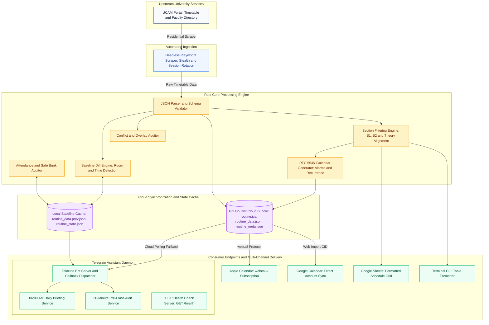

# Academic Routine & Attendance Assistant

[](https://www.rust-lang.org/)
[](LICENSE)
[]()

An autonomous academic timetable engine, RFC 5545 iCalendar synchronizer, official university attendance auditor, and multi-user Telegram assistant built with Rust.

---

## Highlights

- **High-Performance Schedule Core**: Zero-allocation Rust parser handling university timetable schemas, section filtering (`B1`, `B2`, theory `B`), and room double-booking conflict detection.
- **Multi-User Telegram Assistant**: Interactive inline keyboard interface with silent callbacks. Supports personalized section filtering, morning briefings, pre-class reminders, and attendance auditing across multiple users.
- **Live Calendar Subscriptions**: Native Apple Calendar (`webcal://`) and Google Calendar web subscriptions. Devices automatically synchronize when schedules or room allocations change without downloading static files.
- **University Attendance Tracker**: Enforces official university attendance regulations (`Collegiate` $\ge 75\%$, `Non-Collegiate` $60\text{--}74\%$, `Dis-Collegiate` $<60\%$). Calculates exact safe bunk allowances and required recovery classes.
- **Timetable Diff Detection**: Detects room swaps, time shifts, teacher reassignments, and course additions/removals across schedule versions.
- **Faculty Directory**: Search instructors by name, initials, or course code with direct phone call and email action buttons.
- **Decoupled Cloud Architecture**: Scrapes locally or via residential worker, publishes to a synchronized GitHub Gist bundle, and streams updates to cloud bot servers with zero Cloudflare friction.

---

## System Architecture



---

## Telegram Bot Commands

| Command | Arguments | Description |
| :--- | :--- | :--- |
| `/today` | — | Today's classes, room allocations, instructor info, and active session status. |
| `/next` | — | Countdown timer to the immediate next class session. |
| `/routine` | — | Interactive weekly timetable with individual day navigation buttons. |
| `/section` | `[B1 / B2 / All]` | Set or inspect your personalized student section. |
| `/diff` | — | Display room swaps, time shifts, and schedule changes against baseline. |
| `/attendance` | — | View official collegiate status, attendance percentage, and safe bunk math. |
| `/attend` | `<CODE>` | Mark a class session as attended. |
| `/miss` | `<CODE>` | Mark a class session as missed or bunked. |
| `/attendance set`| `<CODE> <ATT> <MIS>`| Set exact attended and missed counts for a course. |
| `/teacher` | `<NAME / CODE>` | Search faculty directory with phone and email action buttons. |
| `/calendar` | — | Live calendar subscription card for Apple and Google Calendar sync. |
| `/alerts` | `[on / off]` | Toggle 6:00 AM daily morning briefings (active by default). |
| `/reminders` | `[on / off]` | Toggle 30-minute pre-class reminders (opt-in). |
| `/free` | — | Calculate free periods, study windows, and break durations. |
| `/complete` | `<CODE>` | Mark completed courses (hides from alerts and calendar feeds). |
| `/resume` | `<CODE>` | Restore a completed or dropped course to your active routine. |
| `/vacation` | `[on / off / until]` | Manage vacation mode to pause morning alerts during breaks. |
| `/sync` | — | Pull latest routine updates from GitHub Gist or UCAM portal. |
| `/status` | — | View system health, active section, vacation state, and alert preferences. |

---

## Attendance Auditor Regulations

The attendance subsystem calculates safe bunks and collegiate standing according to official university rules:

$$
\text{Attendance Percentage} = \frac{\text{Attended Classes}}{\text{Total Held Classes}} \times 100
$$

- **Collegiate ($\ge 75\%$)**: Eligible for final examinations without penalty.
- **Non-Collegiate ($60\% - 74.9\%$)**: Allowed to sit for examinations subject to university fine.
- **Dis-Collegiate ($< 60\%$)**: Disqualified from examinations.

### Safe Bunk and Recovery Mathematics
- **Safe Bunks Allowed**:
  $$\left\lfloor \frac{\text{Attended} - 3 \times \text{Missed}}{3} \right\rfloor$$
- **Classes Needed for Collegiate**:
  $$\max(0, 3 \times \text{Missed} - \text{Attended})$$

> **Privacy & Self-Hosting Model**: Automated UCAM attendance scraping is strictly a self-hosting privilege. The bot never solicits or stores student portal passwords from other users. On a shared bot instance, classmates can manually record their sessions (`/attend`, `/miss`, `/attendance set`) to calculate collegiate thresholds in their private chat. To enable automated attendance extraction directly from UCAM, run your own self-hosted instance using personal credentials in `.env`.

---

## Live Calendar Subscription Setup

Rather than static `.ics` file downloads that become stale when rooms change, the system publishes a live auto-updating calendar feed:

- **Apple Calendar (iOS / iPadOS / macOS)**:
  Tapping **Apple Calendar** opens `webcal://gist.githubusercontent.com/raw/<GIST_ID>/routine.ics`, triggering native one-tap calendar subscription.
- **Google Calendar (Android / Web)**:
  Tapping **Google Calendar** links `https://calendar.google.com/calendar/r?cid=webcal%3A%2F%2F...` directly to the user's Google account, syncing down to mobile devices.
- **Outlook & WebCal**:
  Copy the raw feed link directly into your calendar client.

---

## Command-Line Interface (CLI)

```bash
# Display today's schedule and live session status
academic-routine today

# View full weekly timetable for a specific section
academic-routine --section B2 view

# Inspect schedule differences against previous baseline
academic-routine diff output/routine_data.prev.json output/routine_data.json

# Export RFC 5545 iCalendar with 30-min alarms and sync to Gist
academic-routine export --ics output/routine.ics --sync-gist

# Run headless UCAM scraper on local machine
academic-routine sync-ucam

# Synchronize routine grid to Google Spreadsheet
academic-routine sync-gsheet

# Launch Telegram Assistant Bot with embedded HTTP health check server
academic-routine bot
```

---

## Local Development & Setup

### Prerequisites
- [Rust](https://www.rust-lang.org/tools/install) (2021 edition)
- [Python 3.10+](https://www.python.org/) with `uv` (`uv sync`)
- System Chromium or Google Chrome with `xvfb-run` (for offscreen headless scraping on Linux)

### Environment Configuration
Copy `.env.example` to `.env` and configure credentials:

```bash
cp .env.example .env
```

| Variable | Description |
| :--- | :--- |
| `TELEGRAM_BOT_TOKEN` | Telegram Bot API token from @BotFather (`TELOXIDE_TOKEN` also supported) |
| `ADMIN_CHAT_ID` | Numeric Telegram user ID of owner for admin gate & notifications (`TELEGRAM_CHAT_ID` fallback) |
| `DEFAULT_SECTION` | Default section filter (e.g. `B2`, `B1`, or `All`) |
| `GITHUB_TOKEN` | GitHub Personal Access Token with `gist` scope (`GH_TOKEN` also supported) |
| `GIST_ID` | GitHub Gist ID for public routine and calendar feed distribution |
| `PORT` | Health check server port (defaults to 8000; set `PORT=0` or `DISABLE_HTTP_HEALTHCHECK=1` to disable) |

> [!NOTE]
> **State Architecture & Local Isolation**:
> - Routine state (`routine_state.json`) is strictly local to a single host and must never be shared between different machines. Cloud syncing is strictly limited to public calendar assets (`routine.ics`, `routine_data.json`, `routine_meta.json`).
> - **Concurrent Access**: The background scraper service (`academic-routine-sync.service`) and the long-running bot daemon (`academic-routine.service`) may run simultaneously on the host. Mutations use a reload-before-write pattern via `StateStore` to avoid clobbering concurrent state changes.
> - **Schema Protection**: Binaries older than the on-disk state schema version refuse to start rather than corrupting or resetting the file.
> - **Admin Precedence**: Both the CLI and the daemon prioritize `ADMIN_CHAT_ID` over the fallback `TELEGRAM_CHAT_ID`.

### Verification
Execute the test suite:

```bash
cargo test --all-targets
uv run pytest -q
```

Check code formatting and lints:

```bash
cargo fmt --check
cargo clippy --all-targets
uv run ruff check scraper
```

---

## Production & Self-Hosting Deployment

The project is structured for easy self-hosting across local machines, Docker containers, Linux servers, or cloud PaaS providers.

### Option 1: Docker Container

A multi-stage Dockerfile bundles the optimized Rust binary, headless Chromium, virtual display (Xvfb), and Python dependencies:

```bash
# Build Docker image
docker build -t academic-routine .

# Run container with environment file
docker run -d \
  --name routine-bot \
  -p 8000:8000 \
  --env-file .env \
  academic-routine
```

### Option 2: Linux Systemd User Daemon & Timer

Pre-configured user-level service and timer units are provided in `deployment/`:

- `academic-routine.service`: Runs the Telegram bot daemon and 6:00 AM briefing scheduler with automatic restart.
- `academic-routine-sync.timer`: Automatically executes weekly routine scraping every Saturday at 8:00 PM.

```bash
# Copy systemd units to user services directory
mkdir -p ~/.config/systemd/user
cp deployment/academic-routine*.service ~/.config/systemd/user/
cp deployment/academic-routine-sync.timer ~/.config/systemd/user/

# Reload user daemon and enable services
systemctl --user daemon-reload
systemctl --user enable --now academic-routine.service
systemctl --user enable --now academic-routine-sync.timer

# Enable linger so user services run persistently across reboots
loginctl enable-linger "$USER"
```

### Option 3: Cloud PaaS (Render, Railway, Fly.io)

The bot includes an embedded HTTP health check server listening on `PORT` (`GET /health` and `GET /`) to satisfy zero-downtime platform requirements.

---

## License

This project is licensed under the [MIT License](LICENSE).
