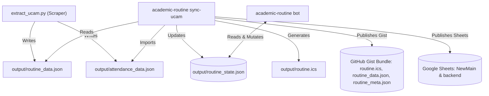

# State Model and Artifact Invariants

This document outlines local and published artifacts, state persistence schemas, concurrency guarantees, and attendance precedence rules.

## 1. Artifact Lifecycle and Storage Roles

All runtime and generated files reside within the `output/` directory:

| Path | Primary Writer | Primary Readers | Visibility | Deletion Safety |
|---|---|---|---|---|
| `output/routine_state.json` | Bot daemon / CLI commands | Bot server, CLI commands | Local only | **Do not delete.** Contains user alert preferences, vacation modes, and attendance counts. |
| `output/routine_state.json.bak` | `StateStore` atomic write | `StateStore::open` (recovery) | Local only | Safe to delete. Automatically recreated on next state mutation. |
| `output/routine_state.json.corrupt-<ts>` | `StateStore::open` | Host administrator | Local only | Safe to delete after inspecting corrupted JSON. |
| `output/routine_data.json` | Scraper / `sync-ucam` | Engine, diff auditor, bot | Published to Gist | Safe to delete, but **not** auto-regenerated: read commands fail with `Current routine file not found` until the next `sync-ucam` writes a new one. |
| `output/routine_data.prev.json` | `sync-ucam` | Diff engine | Local only | Safe to delete. Recreated from current data on subsequent scrape. |
| `output/attendance_data.json` | Scraper (`extract_ucam.py`) | CLI state importer | Local only | Safe to delete. Recreated on subsequent attendance scrape. |
| `output/routine_state.json.pre-<version>` | Manual pre-upgrade backup | Host administrator (recovery) | Local only | Safe to delete. Manual upgrade/rollback backup; keep the latest two. |
| `output/routine.ics` | Engine (`exporters::ics`) | Calendar subscribers | Published to Gist | Safe to delete. Re-exported automatically during sync or export commands. |

## 2. State Schema v2 and Forward Protection

State serialization is governed by `STATE_SCHEMA_VERSION = 2` in `src/model/state.rs`:

- **Downgrade Guard:** When `StateStore::open` encounters a `schema_version` greater than `2`, the process terminates immediately with an error rather than silently overwriting or resetting fields.
- **Corruption Quarantine:** If `routine_state.json` contains malformed JSON, the engine moves the damaged file to `output/routine_state.json.corrupt-<timestamp>` and restores state from `routine_state.json.bak`.
- **Atomic File Writes:** State updates write to `.routine_state.json.tmp-<pid>-<n>` and use atomic filesystem renaming (`std::fs::rename`) to replace the target path safely.

## 3. Concurrency Guarantees

The long-running bot daemon (`academic-routine.service`) and the automated weekly scraper (`academic-routine-sync.service`) execute independently on the same host:

- **Reload-Before-Write Pattern:** `StateStore::update` reloads `routine_state.json` from disk immediately before applying mutations. A CLI attendance import or manual `/attend` command does not clobber concurrent changes made by the other process.
- **Per-Host Boundary:** `routine_state.json` is strictly bound to a single host. State files must never be copied across machines or committed to git.

## 4. Attendance Import Precedence

When automated scraping retrieves official records:

1. **Target Isolation:** Imported attendance records target strictly the chat ID configured in `ADMIN_CHAT_ID`. Other registered users retain their independent manual records.
2. **Selective Course Overwrites:** The import overwrites attendance counts (`attended`, `missed`) exclusively for courses returned in `attendance_data.json`. Any manually added course not returned by the portal is preserved.
3. **Manual Overrides:** Users can issue `/attend`, `/miss`, or `/attendance set <CODE> <ATT> <MIS>` at any time to correct or calibrate counts between scrape cycles.

## 5. Artifact Data Flow

## 6. Known Artifact Behaviors

- **Orphaned Temp Files:** Unclean process exits during atomic state saves may leave orphaned `.routine_state.json.tmp-*` artifacts. These are safe to delete via `rm -f output/.routine_state.json.tmp-*`.
- **Indefinite Recurrence:** The published `routine.ics` feed lacks an `UNTIL` recurrence boundary because the portal does not publish a structured end date for the active semester.

*Last reviewed against v0.3.2 (2026-10-29)*
